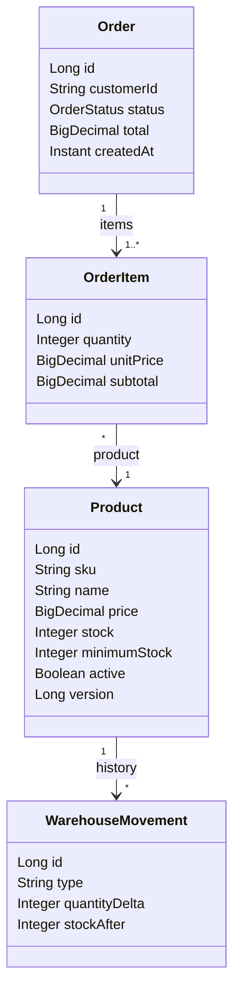

# RetailOrder Service

RetailOrder Service es un microservicio REST para administrar catálogo de
productos, inventario y pedidos de una tienda. Está desarrollado con Java 21 y
Spring Boot 3.5.7, usando Spring MVC, Spring Data JPA, Bean Validation, Flyway y
OpenAPI/Swagger.

La aplicación expone endpoints HTTP para consultar y actualizar productos,
controlar existencias, crear y cancelar pedidos, y consultar los resultados de
procesos asincrónicos relacionados.

## Funcionalidades principales

- Catálogo de productos con SKU único, precio, categoría, stock y mínimo de
  reabastecimiento.
- Búsqueda paginada de productos activos por categoría y rango de precios.
- Desactivación lógica de productos para conservar su historial.
- Consulta, reabastecimiento y ajuste de inventario, con registro de movimientos.
- Creación transaccional de pedidos con uno o más productos.
- Validación de stock y cálculo de precios y totales en el servidor.
- Cambio de estado de pedidos y cancelación idempotente con devolución de stock.
- Procesamiento asincrónico de notificaciones simuladas, alertas y auditoría.
- Documentación interactiva de la API con Swagger UI.

## Arquitectura

El proyecto separa responsabilidades por paquetes:

| Paquete | Responsabilidad |
|---|---|
| `controller` | Endpoints HTTP, validación de solicitudes y códigos de respuesta |
| `dto` | Modelos de entrada y salida de la API; las entidades no se exponen |
| `service` | Reglas de negocio, transacciones y publicación de eventos |
| `repository` | Acceso a datos con Spring Data JPA |
| `model` | Entidades persistentes y estados del dominio |
| `exception` | Errores de dominio y respuesta HTTP uniforme |
| `config` | Configuración de OpenAPI y ejecución asincrónica |

El flujo típico es **HTTP → Controller → DTO/validación → Service → Repository/JPA
→ base de datos → respuesta HTTP**. `GlobalExceptionHandler` convierte errores
de validación y de negocio a una estructura común:

```json
{
  "timestamp": "fecha y hora",
  "status": 400,
  "error": "Bad Request",
  "message": "Descripción del error",
  "path": "/api/v1/products"
}
```

Las operaciones de compra y cancelación son transaccionales y bloquean los
productos involucrados para evitar ventas concurrentes por encima del stock.
Los productos se bloquean en orden de ID para reducir el riesgo de interbloqueos.
Cancelar un pedido ya cancelado no devuelve stock por segunda vez.

### Entidades y relaciones

- `Product`: catálogo, precio y existencias.
- `Order`: cliente, fecha, estado y total.
- `OrderItem`: productos y cantidades que forman un pedido; conserva el precio
  aplicado al momento de la compra.
- `WarehouseMovement`: historial de entradas y salidas de inventario.
- `AsyncEventLog`: resultado observable de las tareas asincrónicas.

Un pedido contiene uno o más detalles, cada detalle se refiere a un producto y
un producto puede tener muchos movimientos de almacén.

### Diagrama de clases



## Base de datos

Flyway administra el esquema con migraciones ubicadas en
`src/main/resources/db/migration`. Hibernate valida el esquema al arrancar; no
crea ni modifica tablas automáticamente.

Las tablas de dominio son `"Product"`, `"Order"` y `"OrderItem"`. Las tablas
auxiliares `warehouse_movements` y `async_event_logs` registran auditoría y
resultados asincrónicos. Flyway guarda las migraciones aplicadas en
`flyway_schema_history`.

- **H2 local:** perfil predeterminado `local`, base en memoria
  `jdbc:h2:mem:retaildb`. Flyway crea el esquema y `data-local.sql` carga los
  datos de demostración en cada inicio. La base vuelve a su estado inicial al
  reiniciar el proceso.
- **PostgreSQL:** perfil `postgres`. Puede iniciarse con Docker Compose para
  desarrollo local o utilizarse desde Kubernetes. Las propiedades pueden
  configurarse mediante `DB_URL`, `DB_USERNAME` y `DB_PASSWORD`.

Los datos locales de H2 contienen seis productos, tres pedidos, cuatro
detalles, cinco movimientos y nueve registros asincrónicos. El sexto producto
está inactivo, por lo que la búsqueda normal de productos devuelve cinco.

Para más detalle sobre tablas, relaciones y flujo de datos consulta
[docs/PROJECT-WALKTHROUGH.md](docs/PROJECT-WALKTHROUGH.md).

## Ejecutar desde Visual Studio Code

1. Instalar JDK 21 y configurar `JAVA_HOME`; comprobar con `java -version`.
2. Abrir la carpeta raíz del proyecto. Instalar las extensiones sugeridas en `.vscode/extensions.json` (Java Extension Pack, Spring Boot Extension Pack y XML).
3. Esperar a que Java/Maven importen el proyecto. El archivo `.vscode/launch.json` contiene las opciones **RetailOrder Service (local/H2)** y **RetailOrder Service (PostgreSQL)**. Seleccionar una y pulsar F5. Para PostgreSQL, iniciar antes Compose.
4. Abrir Swagger UI en <http://localhost:8080/swagger-ui.html>. El documento OpenAPI está en <http://localhost:8080/v3/api-docs>.

La aplicación local arranca con H2. La consola H2 se encuentra en
<http://localhost:8080/h2-console>; JDBC URL `jdbc:h2:mem:retaildb`, usuario
`sa` y contraseña vacía.

## API v1

| Método | Endpoint | Uso |
|---|---|---|
| POST | `/api/v1/products` | Alta con inventario inicial y umbral mínimo |
| GET | `/api/v1/products` | Listado paginado; filtros `category`, `minimumPrice`, `maximumPrice` |
| GET | `/api/v1/products/{id}` | Consulta de producto activo |
| PUT | `/api/v1/products/{id}` | Actualiza catálogo y umbral; el stock no se cambia aquí |
| DELETE | `/api/v1/products/{id}` | Desactivación lógica |
| GET | `/api/v1/inventory/{productId}` | Consulta de existencias |
| POST | `/api/v1/inventory/{productId}/replenishments` | Reabastecimiento con `{"quantity": 10}` |
| POST | `/api/v1/inventory/{productId}/adjustments` | Ajuste con delta `{"quantityDelta": -2}` |
| GET | `/api/v1/inventory/{productId}/movements` | Historial de almacén paginado |
| POST | `/api/v1/orders` | Confirmación transaccional de pedido con uno o más ítems |
| GET | `/api/v1/orders` | Listado paginado |
| GET | `/api/v1/orders/{id}` | Detalle, estado y total |
| PATCH | `/api/v1/orders/{id}/status` | Transición `EN_PROCESO` → `ENVIADO` |
| DELETE | `/api/v1/orders/{id}` | Cancelación lógica e idempotente |
| GET | `/api/v1/async-events` | Resultados observables de tareas secundarias |

Los listados aceptan `page`, `size` (máximo 100) y `sort`. Los precios se manejan con dos decimales y no se redondean silenciosamente: el API rechaza importes con escala/dígitos fuera de contrato. El total se calcula en servidor a partir de precios guardados y cantidades validadas.

Los errores usan `{ "timestamp", "status", "error", "message", "path" }`. Validación y precio inválido devuelven 400; recurso inexistente 404; stock insuficiente, SKU duplicado y transiciones no permitidas 409. No se devuelven trazas ni detalles SQL.

## Procesamiento asincrónico

Los eventos se publican solo después de confirmar la transacción y se ejecutan en el `retailTaskExecutor` acotado. Las interfaces `PurchaseNotificationPort`, `WarehouseAuditPort` y `ReplenishmentAlertPort` separan los efectos secundarios. En esta entrega, la confirmación y alerta son **simuladas**: se registran como resultado, no se envía correo, SMS ni mensaje externo. La auditoría sí persiste movimientos en `warehouse_movements`. `async_event_logs` expone resultados y fallos; los errores también se escriben en el log de aplicación y no revierten la compra confirmada.

La ejecución en memoria no es una cola durable: si el proceso se detiene
inmediatamente tras el commit, una tarea pendiente podría perderse. En
producción, sustituir el despachador por un outbox durable o un sistema de
mensajería es un posible siguiente paso.

## Compilar y probar

Con JDK 21 instalado:

```powershell
.\mvnw.cmd clean verify
.\mvnw.cmd spring-boot:run
```

El proyecto incluye pruebas REST e integración en `src/test/java`, con H2
aislado en perfil `test`. Desde VS Code también pueden ejecutarse en la vista
Testing o con **Java: Run Tests**. El wrapper se fija a Maven 3.9.9 y descarga
la distribución oficial si hace falta. La guía reproducible de pruebas
interactivas Swagger, con solicitudes y resultados esperados, está en
[docs/MANUAL-TESTING.md](docs/MANUAL-TESTING.md). Swagger permite pruebas
manuales; **no sustituye** las pruebas automatizadas JUnit/MockMvc.

## Docker y Kubernetes

Docker empaqueta la aplicación y Java 21 en una imagen ejecutable. Kubernetes
ejecuta esa imagen, supervisa los pods y proporciona un Service estable para
recibir solicitudes. En el despliegue de este proyecto hay tres réplicas de la
API compartiendo PostgreSQL.

PostgreSQL corre en un pod con una réplica y un PersistentVolumeClaim (PVC)
montado en su directorio de datos. El PVC conserva la base cuando se reemplaza
el pod, pero **no es un respaldo**. La base no se publica directamente al
navegador: el Service de la API expone HTTP y la aplicación consulta PostgreSQL
internamente.

Los archivos de despliegue son:

- `Dockerfile` y `.dockerignore`: construcción de la imagen de la aplicación.
- `k8s/postgres.yaml`: PostgreSQL, Service interno y PVC.
- `k8s/api-configmap.yaml`: perfil y conexión no confidencial de la API.
- `k8s/api-deployment.yaml`: tres réplicas de la API.
- `k8s/api-service.yaml`: acceso HTTP al servicio.
- `k8s/postgres-seed.sql`: datos de demostración para PostgreSQL; se ejecuta
  manualmente una sola vez en una base preparada.

La contraseña se proporciona mediante el Secret `retail-db-secret`, que se
crea en el clúster y no se almacena en los manifiestos del repositorio. Para
acceso local se puede usar `kubectl port-forward`; Swagger UI se sirve en
`http://localhost:8080/swagger-ui.html`.

Con Docker Desktop y Kubernetes habilitados, desde CMD en la raíz del proyecto:

```cmd
docker build -t retail-order-service:1.0.1 .
kubectl create secret generic retail-db-secret --from-literal=DB_PASSWORD=retail_dev --dry-run=client -o yaml | kubectl apply -f -
kubectl apply -f k8s\postgres.yaml
kubectl rollout status deployment/postgres --timeout=180s
kubectl apply -f k8s\api-configmap.yaml
kubectl apply -f k8s\api-deployment.yaml
kubectl apply -f k8s\api-service.yaml
kubectl rollout status deployment/retail-api --timeout=600s
kubectl port-forward service/retail-api 8080:80
```

Deja abierto el último comando y visita
<http://localhost:8080/swagger-ui.html>. Para cargar datos de demostración en
una base recién creada, ejecuta una sola vez el seed manual descrito en
[docs/KUBERNETES-FILES.md](docs/KUBERNETES-FILES.md); no lo repitas sobre una
base ya sembrada.

La guía con explicación de cada archivo, comandos de despliegue y verificación
desde consola y Docker Desktop está en
[docs/KUBERNETES-FILES.md](docs/KUBERNETES-FILES.md).
