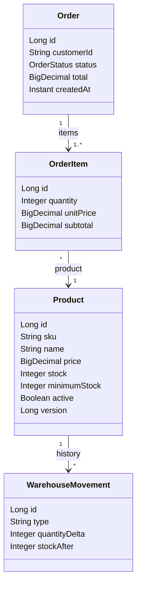
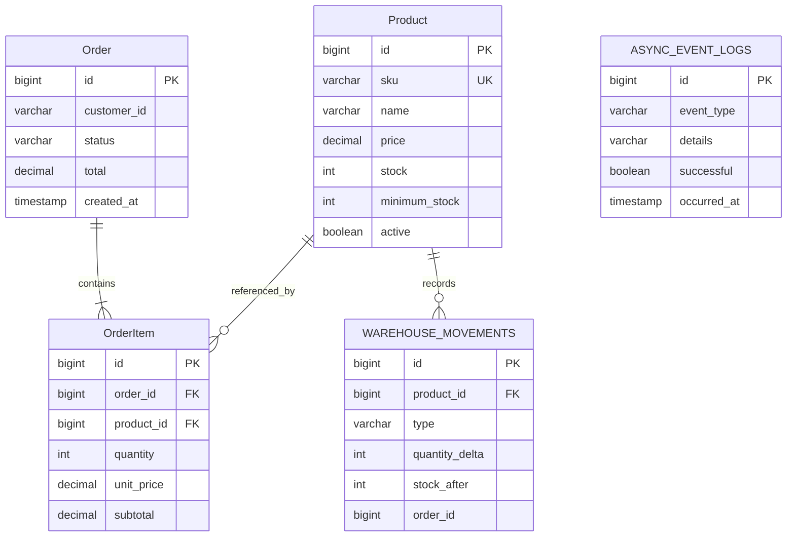

# RetailOrder Service

Microservicio REST para administrar catálogo, existencias y pedidos retail. Requiere JDK 21. Está implementado con Java 21, Spring Boot 3.5.7, Spring MVC, Spring Data JPA, Bean Validation, Flyway y OpenAPI.

## Cambios de modelo y base de datos

Las entidades JPA principales se mapean a las tablas `"Product"`, `"Order"` y `"OrderItem"` (con mayúsculas y nombres exactos en H2). La migración `V2__rename_domain_tables.sql` renombra las tablas que V1 creó como `products`, `purchase_orders` y `order_items`; los registros existentes y las relaciones se conservan. Las tablas auxiliares `warehouse_movements` y `async_event_logs` permanecen porque soportan auditoría y tareas asincrónicas.

Los contratos HTTP mantienen sus rutas y nombres de campos JSON para no romper clientes. Los DTOs se redujeron de varios archivos independientes a cuatro grupos: `ProductDtos`, `OrderDtos`, `InventoryDtos` y `ApiDtos`. Swagger UI organiza las operaciones bajo tres etiquetas: `Product`, `Order` y `OrderItem`; las operaciones que crean o muestran el detalle del pedido aparecen tanto en Order como en OrderItem. Los contratos documentados incluyen esquemas como `OrderCreateRequest`, `OrderItemRequest`, `OrderResponse` y `ProductResponse`; no se publican las entidades JPA directamente. Swagger UI conserva su dirección `/swagger-ui.html`.

Al cambiar el esquema, reinicia la aplicación para que Flyway ejecute V2. En H2 Console, busca los nombres entre comillas `"Product"`, `"Order"` y `"OrderItem"`; `warehouse_movements` y `async_event_logs` siguen apareciendo por diseño.

## Arquitectura

Los controladores REST (`controller`) validan y traducen solicitudes a DTOs. Los servicios (`service`) implementan reglas de negocio y límites transaccionales. Los repositorios (`repository`) acceden a entidades JPA (`model`). `GlobalExceptionHandler` traduce errores de dominio y validación al formato HTTP común. Las respuestas y solicitudes no exponen entidades JPA.

Las compras y cancelaciones usan transacciones y bloqueos pesimistas por producto, ordenando los IDs antes de adquirir los bloqueos. Así se serializan compras concurrentes sobre el mismo inventario y se evita el stock negativo. Las cancelaciones también bloquean el pedido; una cancelación ya aplicada responde el estado existente sin una segunda devolución.

### Diagrama de clases (Mermaid)



Las clases `Product`, `Order` y `OrderItem` corresponden a las entidades JPA. Las solicitudes y respuestas descritas en Swagger son DTOs del paquete `dto`.

### DER (Mermaid)



## Base de datos

- **Local rápido:** H2 en memoria con el perfil `local` (perfil predeterminado). Flyway crea el esquema y `data-local.sql` carga productos, pedidos, detalles, movimientos y resultados asincrónicos de demostración. Al reiniciar la aplicación, los datos vuelven a su estado inicial.
- El conjunto local incluye 6 productos, 3 pedidos, 4 detalles, 5 movimientos y 9 resultados asincrónicos demostrativos. Los IDs se generan automáticamente; las FK se enlazan mediante SKU y cliente.
- **PostgreSQL:** iniciar `docker compose up -d postgres` y ejecutar la app con el perfil `postgres`. Compose incluye únicamente credenciales locales de demostración; reemplácelas en cualquier entorno compartido. También se aceptan `DB_URL`, `DB_USERNAME` y `DB_PASSWORD` como variables de entorno.
- El esquema se crea y versiona en `src/main/resources/db/migration`. Hibernate valida el esquema de Flyway; no genera ni actualiza tablas automáticamente.

Para una explicación detallada de las tablas `warehouse_movements`, `async_event_logs` y `flyway_schema_history`, así como los flujos de negocio y asincronía, consulta [docs/PROJECT-WALKTHROUGH.md](docs/PROJECT-WALKTHROUGH.md).

## Ejecutar desde Visual Studio Code

1. Instalar JDK 21 y configurar `JAVA_HOME`; comprobar con `java -version`.
2. Abrir la carpeta raíz del proyecto. Instalar las extensiones sugeridas en `.vscode/extensions.json` (Java Extension Pack, Spring Boot Extension Pack y XML).
3. Esperar a que Java/Maven importen el proyecto. El archivo `.vscode/launch.json` contiene las opciones **RetailOrder Service (local/H2)** y **RetailOrder Service (PostgreSQL)**. Seleccionar una y pulsar F5. Para PostgreSQL, iniciar antes Compose.
4. Abrir Swagger UI en <http://localhost:8080/swagger-ui.html>. El documento OpenAPI está en <http://localhost:8080/v3/api-docs>.

La aplicación local arranca con H2. La consola H2 se encuentra en <http://localhost:8080/h2-console>; JDBC URL `jdbc:h2:mem:retaildb`, usuario `sa` y contraseña vacía.

## API v1

| Método | Endpoint | Uso |
|---|---|---|
| POST | `/api/v1/products` | Alta con inventario inicial y umbral mínimo |
| GET | `/api/v1/products` | Listado paginado; filtros `category`, `minimumPrice`, `maximumPrice` |
| GET | `/api/v1/products/{id}` | Consulta de producto activo |
| PUT | `/api/v1/products/{id}` | Actualiza catálogo y umbral; el stock no se cambia aquí |
| DELETE | `/api/v1/products/{id}` | Desactivación lógica |
| GET | `/api/v1/inventory/{productId}` | Consulta de existencias |
| POST | `/api/v1/inventory/{productId}/replenishments` | Reabastecimiento con `{"quantity": 10}` |
| POST | `/api/v1/inventory/{productId}/adjustments` | Ajuste con delta `{"quantityDelta": -2}` |
| GET | `/api/v1/inventory/{productId}/movements` | Historial de almacén paginado |
| POST | `/api/v1/orders` | Confirmación transaccional de pedido con uno o más ítems |
| GET | `/api/v1/orders` | Listado paginado |
| GET | `/api/v1/orders/{id}` | Detalle, estado y total |
| PATCH | `/api/v1/orders/{id}/status` | Transición `EN_PROCESO` → `ENVIADO` |
| DELETE | `/api/v1/orders/{id}` | Cancelación lógica e idempotente |
| GET | `/api/v1/async-events` | Resultados observables de tareas secundarias |

Los listados aceptan `page`, `size` (máximo 100) y `sort`. Los precios se manejan con dos decimales y no se redondean silenciosamente: el API rechaza importes con escala/dígitos fuera de contrato. El total se calcula en servidor a partir de precios guardados y cantidades validadas.

Los errores usan `{ "timestamp", "status", "error", "message", "path" }`. Validación y precio inválido devuelven 400; recurso inexistente 404; stock insuficiente, SKU duplicado y transiciones no permitidas 409. No se devuelven trazas ni detalles SQL.

## Procesamiento asincrónico

Los eventos se publican solo después de confirmar la transacción y se ejecutan en el `retailTaskExecutor` acotado. Las interfaces `PurchaseNotificationPort`, `WarehouseAuditPort` y `ReplenishmentAlertPort` separan los efectos secundarios. En esta entrega, la confirmación y alerta son **simuladas**: se registran como resultado, no se envía correo, SMS ni mensaje externo. La auditoría sí persiste movimientos en `warehouse_movements`. `async_event_logs` expone resultados y fallos; los errores también se escriben en el log de aplicación y no revierten la compra confirmada.

La ejecución en memoria no es una cola durable: si el proceso se detiene inmediatamente tras el commit, una tarea pendiente podría perderse. En producción, sustituir el despachador por un outbox durable/mensajería es el siguiente paso.

## Compilar y probar

Con JDK 21 instalado:

```powershell
.\mvnw.cmd clean verify
.\mvnw.cmd spring-boot:run
```

El proyecto incluye pruebas REST e integración en `src/test/java`, con H2 aislado en perfil `test`. Desde VS Code también pueden ejecutarse en la vista Testing o con **Java: Run Tests**. El wrapper se fija a Maven 3.9.9 y descarga la distribución oficial si hace falta. La guía reproducible de pruebas interactivas Swagger, con solicitudes y resultados esperados, está en [docs/MANUAL-TESTING.md](docs/MANUAL-TESTING.md). Swagger permite pruebas manuales; **no sustituye** las pruebas automatizadas JUnit/MockMvc.
