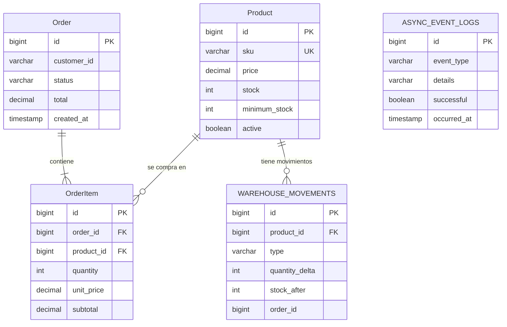

# Funcionamiento detallado de RetailOrder Service

Esta guía recorre el proyecto desde el inicio de la aplicación hasta las tablas de la base de datos y el flujo de productos, inventario, pedidos y tareas asincrónicas. Describe la implementación actual, no una arquitectura futura.

## 1. Resumen del sistema

RetailOrder Service es una API REST para administrar un catálogo retail, sus existencias y pedidos de compra. Está desarrollado con Java 21 y Spring Boot 3.5.7. La base de datos se accede mediante Spring Data JPA; Flyway administra el esquema y springdoc publica la especificación OpenAPI y Swagger UI.

En local, la aplicación usa H2 en memoria. Para un entorno local más parecido a producción se puede utilizar PostgreSQL con Docker Compose.

La aplicación separa las responsabilidades así:

| Paquete | Responsabilidad |
|---|---|
| `controller` | Recibir solicitudes HTTP, validar DTOs y devolver respuestas HTTP |
| `dto` | Definir los cuerpos de entrada y salida de la API, agrupados en cuatro archivos por área; evita exponer entidades JPA |
| `service` | Aplicar reglas de negocio y delimitar transacciones |
| `repository` | Consultar y guardar datos mediante Spring Data JPA |
| `model` | Entidades persistentes (`Product`, `Order`, `OrderItem`, inventario y logs) y enum de estado |
| `exception` | Excepciones de dominio y traducción centralizada a errores HTTP |
| `config` | Configuración de OpenAPI y del ejecutor asincrónico |

El punto de entrada es `RetailserviceApplication`. Al iniciar, Spring Boot carga el perfil, configura el `DataSource`, ejecuta Flyway y valida las entidades frente al esquema (`spring.jpa.hibernate.ddl-auto=validate`). Después registra controladores, servicios, repositorios y el ejecutor de tareas en segundo plano.

### Recorrido de inicio de la aplicación

1. `RetailserviceApplication` inicia Spring Boot y activa el perfil configurado. Si no se especifica uno, se usa `local`.
2. Spring carga `application.properties` y las propiedades del perfil: local configura H2; `postgres` conecta con PostgreSQL; `test` usa una base H2 aislada para pruebas.
3. Flyway revisa `flyway_schema_history`. En una base nueva ejecuta las migraciones versionadas en orden; en una base existente ejecuta solo las que aún no estén registradas.
4. En el perfil `local`, Spring ejecuta `data-local.sql` para cargar el conjunto demostrativo. Ese script no define el esquema: las tablas y sus relaciones pertenecen a las migraciones Flyway.
5. Hibernate compara las entidades con el esquema mediante `ddl-auto=validate`. Si hay una diferencia de tablas o columnas, el arranque falla en vez de modificar el esquema silenciosamente.
6. Spring crea los controladores, servicios y repositorios, y configura el ejecutor para trabajos asincrónicos. La aplicación queda disponible para solicitudes HTTP.

El recorrido posterior de una operación es, en términos generales: **solicitud HTTP → controlador → DTO/validación → servicio/reglas de negocio → repositorio/entidad → respuesta HTTP**. Cuando la operación publica eventos, esos trabajos secundarios esperan a que la transacción principal confirme sus cambios.

### Entidades y DTOs actuales

- `Product` se mapea a la tabla física `"Product"`.
- `Order` se mapea a la tabla física `"Order"`. El nombre JPQL de la entidad es `RetailOrder`, para que las consultas sean inequívocas.
- `OrderItem` se mapea a `"OrderItem"`; sus relaciones `ManyToOne` apuntan a `Order` y `Product`.
- Los DTOs están agrupados en cuatro archivos: `ProductDtos.java`, `OrderDtos.java`, `InventoryDtos.java` y `ApiDtos.java`. Las operaciones de alta y actualización usan DTOs separados cuando tienen campos distintos.
- Los nombres y formatos JSON de las solicitudes/respuestas no cambiaron al agrupar los DTOs.

La migración V1 creó inicialmente `products`, `purchase_orders` y `order_items`. La migración `V2__rename_domain_tables.sql` renombra esas tablas a `"Product"`, `"Order"` y `"OrderItem"` sin borrar ni volver a insertar filas; las claves foráneas se mantienen. `warehouse_movements`, `async_event_logs` y `flyway_schema_history` permanecen con esos nombres.

Swagger muestra exactamente tres etiquetas principales: `Product`, `Order` y `OrderItem`. Los endpoints de productos e inventario se agrupan bajo `Product`; las operaciones de pedido y eventos bajo `Order`; crear/consultar pedido aparece también bajo `OrderItem`, porque solicita/devuelve líneas de pedido. Swagger documenta DTOs con nombres estables (`ProductCreateRequest`, `ProductUpdateRequest`, `ProductResponse`, `OrderCreateRequest`, `OrderItemRequest`, `OrderItemResponse`, `OrderResponse`, `OrderStatusRequest`, inventario y errores). Las rutas y propiedades JSON conservan la compatibilidad; Swagger UI permanece en `/swagger-ui.html`.

## 2. Qué significan las tablas consultadas

### 2.1 `warehouse_movements`: historial de cambios de inventario

Es una tabla de **auditoría de movimientos del almacén**. Cada fila representa un cambio aplicado al stock de un producto. No es la fuente principal del stock actual: ese valor se mantiene en `"Product".stock`. El historial permite responder preguntas como “¿qué operación modificó las existencias?”, “¿cuántas unidades entraron o salieron?” y “¿qué quedó después del movimiento?”.

Columnas:

| Columna | Significado |
|---|---|
| `id` | Identificador del movimiento |
| `product_id` | Producto afectado; tiene una FK a `"Product".id` |
| `type` | Motivo operativo, por ejemplo `REABASTECIMIENTO`, `AJUSTE`, `VENTA` o `DEVOLUCION_CANCELACION` |
| `quantity_delta` | Variación firmada: positivo suma stock y negativo resta |
| `stock_after` | Existencia del producto después de aplicar ese movimiento |
| `order_id` | Pedido relacionado, si el movimiento viene de una compra/cancelación; es nullable y actualmente no tiene FK declarada |
| `occurred_at` | Fecha y hora del registro |

Ejemplo conceptual: si un producto tiene 20 unidades y un pedido vende 2, el stock principal pasa a 18. El movimiento correspondiente queda conceptualmente así: `type=VENTA`, `quantity_delta=-2`, `stock_after=18`, `order_id=<id del pedido>`.

Los movimientos se generan desde las operaciones de reabastecimiento, ajuste, confirmación de pedido y cancelación. Se publican como eventos y la fila se persiste **después del commit de la transacción principal**. Por eso puede haber una demora breve antes de que aparezca en `GET /api/v1/inventory/{productId}/movements`.

Un aspecto importante de la implementación actual: la creación de un producto con stock inicial no registra un movimiento de apertura. Los ajustes al catálogo tampoco cambian el stock. El stock debe modificarse mediante endpoints de inventario o mediante una compra/cancelación.

### 2.2 `async_event_logs`: resultado observable de trabajos secundarios

Esta tabla registra el resultado de algunas tareas asincrónicas, no cada movimiento de negocio. Su propósito es permitir que un desarrollador vea si se ejecutó una notificación simulada, una alerta o una auditoría, y si el adaptador informó un error.

Columnas:

| Columna | Significado |
|---|---|
| `id` | Identificador del registro |
| `event_type` | Tipo de resultado, por ejemplo `NOTIFICACION_COMPRA`, `AUDITORIA_INVENTARIO`, `ALERTA_REABASTECIMIENTO`; los fallos guardan el tipo interno del evento que falló |
| `details` | Descripción corta y legible del resultado |
| `successful` | `true` si el adaptador terminó sin lanzar una excepción; `false` si el listener capturó un error |
| `occurred_at` | Fecha y hora del registro |

Ejemplos:

- Al confirmar un pedido, `NOTIFICACION_COMPRA` indica que se ejecutó la **simulación local** de la confirmación. No significa que se enviara un correo, SMS o mensaje externo.
- Al guardar un movimiento, `AUDITORIA_INVENTARIO` confirma que se procesó la escritura de auditoría. El detalle del movimiento completo está en `warehouse_movements`.
- Cuando el stock alcanza o cruza el mínimo configurado, `ALERTA_REABASTECIMIENTO` registra la alerta **simulada**.
- Si un adaptador falla, el listener registra un evento con `successful=false` y escribe el detalle técnico en el log de la aplicación. La descripción almacenada en la tabla es intencionalmente general.

Se consultan mediante `GET /api/v1/async-events`. Los resultados son paginados. La tabla no es un sistema de colas ni una bandeja de reintentos: registra resultados, pero no conserva una tarea pendiente recuperable.

El guardado del movimiento y el guardado de su registro `AUDITORIA_INVENTARIO` son llamadas de repositorio separadas después del commit del pedido. Si ocurre un fallo entre ambas, una puede persistirse sin la otra. La fila `successful=true` refleja que el adaptador terminó sin excepción; no es una garantía de entrega de un proveedor externo.

El perfil `local` precarga filas de ejemplo en esta tabla con `data-local.sql` para que se pueda explorar desde Swagger/H2 sin crear operaciones primero. Esos registros están marcados como datos de demostración en `details`: su presencia inicial no significa que el listener haya ejecutado esas tareas durante el arranque.

### Registros incluidos al iniciar con el perfil `local`

El conjunto está relacionado entre sí y usa IDs generados por la base (las relaciones se resuelven por SKU y cliente, no por IDs codificados):

| Tabla | Filas | Ejemplos |
|---|---:|---|
| `"Product"` | 6 | Café, taza, té bajo mínimo, libreta, botella sin stock y café de temporada desactivado |
| `"Order"` | 3 | Un pedido `EN_PROCESO`, uno `ENVIADO` y uno `CANCELADO` |
| `"OrderItem"` | 4 | Detalles vinculados a los tres pedidos y sus productos |
| `warehouse_movements` | 5 | Ventas de ejemplo y una devolución que ilustra la cancelación |
| `async_event_logs` | 9 | Registros de demostración de auditoría, notificación simulada y alerta simulada |
| `flyway_schema_history` | Administrada por Flyway | Versiones de migraciones aplicadas; no se rellena en `data-local.sql` |

El precio y total de los pedidos de ejemplo coinciden con sus detalles: pedido `cliente-demo-001` suma 340.00; `cliente-demo-002` suma 130.00; y `cliente-demo-003` suma 97.00 y tiene una venta más una devolución. El té queda en 3 unidades con mínimo 4 para que el ejemplo represente un pedido que cruza el umbral. La botella tiene cero existencias para poder probar stock insuficiente.

### 2.3 `flyway_schema_history`: control de versiones del esquema

`flyway_schema_history` es una tabla **técnica que crea y administra Flyway**. No representa productos, pedidos, stock ni tareas asincrónicas. Flyway la utiliza para saber qué migraciones de base de datos ya ejecutó y evitar ejecutar dos veces los mismos cambios.

Flyway guarda metadatos de cada migración, entre ellos su versión, descripción, tipo, script, checksum, fecha de instalación y resultado. En este repositorio, la primera migración es `V1__create_retail_schema.sql`. Al iniciar sobre una base vacía, Flyway:

1. Crea `flyway_schema_history` si todavía no existe.
2. Ejecuta el script `V1__create_retail_schema.sql`.
3. Ejecuta `V2__rename_domain_tables.sql`, que cambia los nombres de las tres tablas principales y conserva las relaciones.
4. Registra cada migración aplicada en `flyway_schema_history`.
5. Hibernate valida que el mapeo de las entidades coincide con el esquema final.

En una base que ya tiene V1 aplicada, Flyway no vuelve a ejecutar V1: ejecuta V2 y conserva las filas existentes. Si V2 ya aparece como exitosa en `flyway_schema_history`, no necesita ejecutarse otra vez.

No se declara `flyway_schema_history` en el SQL de V1 porque es infraestructura del propio Flyway. No debe editarse manualmente ni confundirse con una tabla de historial comercial.

Para evolucionar el esquema después de estas dos migraciones, se agrega otro archivo versionado, por ejemplo `V3__add_customer_email.sql`. No se modifica una migración ya aplicada en un entorno compartido: Flyway compara su checksum con el que registró y detecta cambios inesperados.

## 3. Relación entre las tablas de negocio

Las entidades principales se almacenan así:

- `"Product"`: catálogo, estado activo e inventario actual.
- `"Order"`: cabecera del pedido, cliente, estado, total y fecha.
- `"OrderItem"`: detalle con producto, cantidad y precio unitario histórico.
- `warehouse_movements`: auditoría de los cambios de inventario.
- `async_event_logs`: resultados de tareas secundarias.
- `flyway_schema_history`: registro de migraciones, mantenido por Flyway.

Relaciones:



`"OrderItem".unit_price` y `"OrderItem".subtotal` conservan los importes usados al confirmar el pedido. Si el producto cambia de precio después, el detalle del pedido histórico no se recalcula.

## 4. Flujo HTTP de una solicitud

1. El cliente llama un endpoint bajo `/api/v1`.
2. El controlador convierte el JSON a un DTO y Bean Validation verifica las restricciones declaradas.
3. El controlador delega la operación al servicio correspondiente.
4. El servicio aplica reglas de dominio dentro de una transacción cuando la operación modifica datos.
5. El repositorio consulta o modifica las entidades JPA.
6. El controlador devuelve un DTO de salida; las entidades no se serializan directamente.
7. Si ocurre una excepción conocida, `GlobalExceptionHandler` genera un cuerpo común:

   ```json
   {
     "timestamp": "2026-01-15T12:00:00Z",
     "status": 409,
     "error": "Conflict",
     "message": "Stock insuficiente para el producto 10",
     "path": "/api/v1/orders"
   }
   ```

   El valor de fecha anterior es solo una muestra del formato. El status depende del error: 400 para validaciones/entrada inválida, 404 para recursos ausentes y 409 para stock/conflictos de estado.

## 5. Productos y catálogo

### Alta

`POST /api/v1/products` recibe SKU, nombre, descripción, categoría, precio, stock inicial y mínimo de stock. Valida el DTO y el precio, comprueba el SKU, guarda el producto y devuelve `201 Created`. Si el stock inicial está en el mínimo o por debajo, publica una alerta asincrónica.

El SKU es único en base de datos. El servicio también intenta detectar una coincidencia sin distinguir mayúsculas/minúsculas para devolver un mensaje de conflicto más claro.

### Consulta y listado

- `GET /api/v1/products/{id}` devuelve productos activos; si el ID no existe o está desactivado, responde 404.
- `GET /api/v1/products` solo lista productos activos y admite `category`, `minimumPrice`, `maximumPrice`, `page`, `size` y ordenamiento.

### Actualización y desactivación

`PUT /api/v1/products/{id}` actualiza SKU, nombre, descripción, categoría, precio y umbral mínimo. No acepta una nueva cantidad de stock; para cambiarla se usan operaciones explícitas de inventario.

`DELETE /api/v1/products/{id}` no borra físicamente la fila: establece `active=false`. El producto deja de aparecer en el catálogo y no se puede incluir en pedidos nuevos. Se mantiene la fila para que los pedidos y detalles históricos sigan apuntando al producto.

## 6. Inventario

El número actual está en `"Product".stock`; `minimum_stock` define el umbral que puede provocar alerta.

- `GET /api/v1/inventory/{productId}` consulta stock de un producto activo.
- `POST /api/v1/inventory/{productId}/replenishments` recibe `{"quantity": 10}` y suma una cantidad estrictamente positiva.
- `POST /api/v1/inventory/{productId}/adjustments` recibe `{"quantityDelta": -2}`. El delta puede ser positivo o negativo, pero no cero y el nuevo stock no puede quedar negativo.
- `GET /api/v1/inventory/{productId}/movements` presenta el historial auditado, incluidas las operaciones que ya fueron procesadas por el listener asincrónico.

Las operaciones que cambian stock bloquean el registro del producto mientras dure la transacción. Si el stock nuevo cruza el umbral mínimo desde arriba hacia abajo, se publica una alerta. En la creación inicial, en cambio, se publica cuando el stock ya queda en el umbral o por debajo.

## 7. Creación de pedido: procesamiento sincrónico

`POST /api/v1/orders` recibe `customerId` y una lista de producto/cantidad. El cliente no envía precios ni el total.

La secuencia del servicio es:

1. Agrupar cantidades repetidas del mismo producto y ordenar los IDs.
2. Bloquear los productos activos en orden de ID para evitar carreras de inventario y reducir riesgo de deadlock.
3. Confirmar que cada producto existe, sigue activo y tiene stock suficiente.
4. Si falta stock en cualquier producto, lanzar conflicto antes de guardar el pedido; la transacción no conserva descuentos parciales.
5. Descontar stock y construir los detalles usando el precio actual de cada producto.
6. Calcular subtotales y total en el servidor con `BigDecimal`.
7. Guardar y hacer flush de la cabecera y sus detalles.
8. Publicar eventos para auditoría del stock, alerta de bajo inventario cuando corresponda y confirmación de compra.
9. Hacer commit de la transacción. Los listeners asincrónicos se ejecutan solamente después de ese commit.

La estrategia de bloqueo pesimista permite que dos compras concurrentes de la última unidad no puedan confirmar ambas: la primera adquiere el bloqueo y descuenta; la segunda continúa después, ve el stock actualizado y recibe 409.

## 8. Estados y cancelación de pedidos

Los estados de la enumeración `OrderStatus` son:

- `EN_PROCESO`: estado al crear el pedido.
- `ENVIADO`: se permite la transición desde `EN_PROCESO`.
- `CANCELADO`: estado aplicado por el endpoint de cancelación.

`PATCH /api/v1/orders/{id}/status` solo acepta `EN_PROCESO → ENVIADO`. Las demás transiciones devuelven 409. Un pedido enviado no se puede cancelar mediante el endpoint actual.

`DELETE /api/v1/orders/{id}`:

1. Bloquea el pedido.
2. Si ya está `CANCELADO`, devuelve el pedido sin devolver stock otra vez.
3. Si no está `EN_PROCESO`, devuelve 409.
4. Bloquea los productos afectados en orden de ID.
5. Devuelve cada cantidad al stock y publica los movimientos de devolución.
6. Cambia el estado a `CANCELADO` y confirma todo en una misma transacción.

La respuesta del DELETE contiene la representación del pedido cancelado (`200 OK`), no `204`, porque incluye el estado actualizado.

## 9. Cómo funcionan las tareas asincrónicas

Los servicios publican objetos `RetailAsyncEvent` dentro de la transacción principal. `RetailAsyncEventListener` está configurado con `@TransactionalEventListener(phase = AFTER_COMMIT)` y `@Async("retailTaskExecutor")`:

- En la consola de la aplicación se registra el inicio y la finalización de cada tarea, con una descripción concreta: pedido notificado, movimiento y variación de inventario, o producto y umbral de una alerta. Los mensajes aparecen en el hilo `retail-async-*` y las alertas/notificaciones locales también muestran su mensaje simulado.
- **`ORDER_CONFIRMED`** llama a `PurchaseNotificationPort`. La implementación local escribe un mensaje de confirmación simulada en el log y registra el resultado en `async_event_logs`.
- **`WAREHOUSE_AUDIT`** llama a `WarehouseAuditPort`. La implementación local guarda `WarehouseMovement` en `warehouse_movements` y registra `AUDITORIA_INVENTARIO` en `async_event_logs`.
- **`LOW_STOCK`** llama a `ReplenishmentAlertPort`. La implementación local escribe una alerta simulada en el log y registra `ALERTA_REABASTECIMIENTO`.

El `retailTaskExecutor` tiene 2 threads base, un máximo de 4 y una cola de 100 tareas. Si el adaptador lanza una excepción de ejecución, el listener registra el error en consola y trata de guardar un resultado fallido. El error secundario no revierte la compra que ya hizo commit.

No todos los cambios de la API generan tareas asincrónicas. Se registran en consola los eventos que la aplicación publica: movimientos de inventario (reabastecimiento, ajuste, venta y devolución por cancelación), confirmación de pedido y alertas al alcanzar el umbral mínimo. Por ejemplo, editar la descripción de un producto o desactivarlo no publica por sí solo un evento secundario; una solicitud que no cambia inventario ni genera alerta tampoco produce esos mensajes.

**Límite importante:** los eventos se mantienen en memoria y no usan outbox ni broker durable. Si el proceso cae tras el commit y antes de terminar el trabajo, la tarea puede perderse. Es adecuado para demostración/local, pero una operación productiva que requiera entrega garantizada debería usar outbox transaccional o mensajería persistente.

## 10. Cómo identificar los eventos en base de datos

Una compra normalmente produce:

1. Una fila de pedido en `"Order"`.
2. Una fila por producto/cantidad en `"OrderItem"`.
3. Después del commit, una fila `VENTA` por producto afectado en `warehouse_movements`.
4. Un resultado `AUDITORIA_INVENTARIO` por movimiento en `async_event_logs`.
5. Un `NOTIFICACION_COMPRA` en `async_event_logs` (simulado).
6. Un `ALERTA_REABASTECIMIENTO` en `async_event_logs` solo si el stock alcanzó/cruzó el mínimo.

La tabla de movimientos puede tardar un instante en reflejar la operación. Consulte también `GET /api/v1/async-events` para ver qué tareas secundarias finalizaron. La API de movimientos conserva los datos detallados del inventario; la API de eventos no es una segunda fuente de stock.

## 11. Migraciones y perfiles de base de datos

La migración inicial `V1__create_retail_schema.sql` crea las tablas originales y sus claves/índices. `V2__rename_domain_tables.sql` renombra las tres tablas de dominio a `"Product"`, `"Order"` y `"OrderItem"` conservando datos y relaciones. Flyway registra ambas migraciones en `flyway_schema_history`; no se edita esa tabla manualmente.

Configuración común:

- `spring.flyway.enabled=true`: Flyway administra las migraciones.
- `spring.jpa.hibernate.ddl-auto=validate`: Hibernate valida el esquema, no lo crea ni lo altera.
- `spring.jpa.open-in-view=false`: las entidades no quedan abiertas para carga tardía durante el renderizado HTTP.

Perfiles disponibles:

| Perfil | Base de datos | Datos de demostración |
|---|---|---|
| `local` (predeterminado) | H2 en memoria `retaildb` | `data-local.sql` carga ejemplos relacionados en todas las tablas de negocio; se reinician al reiniciar la app |
| `test` | H2 aislada `retailtest` | No carga catálogo de demostración; cada suite prepara sus productos |
| `postgres` | PostgreSQL, URL configurable mediante variables | No carga los dos productos de H2 |

Para PostgreSQL, `docker-compose.yml` ofrece un contenedor local. Las credenciales de Compose son solo de desarrollo y no deben reutilizarse en ambientes compartidos.

## 12. API y códigos HTTP

| Método | Ruta | Resultado normal |
|---|---|---|
| `POST` | `/api/v1/products` | `201 Created` |
| `GET` | `/api/v1/products` | `200 OK`, página |
| `GET` | `/api/v1/products/{id}` | `200 OK` o `404 Not Found` |
| `PUT` | `/api/v1/products/{id}` | `200 OK` |
| `DELETE` | `/api/v1/products/{id}` | `204 No Content` |
| `GET` | `/api/v1/inventory/{productId}` | `200 OK` |
| `POST` | `/api/v1/inventory/{productId}/replenishments` | `200 OK` |
| `POST` | `/api/v1/inventory/{productId}/adjustments` | `200 OK` |
| `GET` | `/api/v1/inventory/{productId}/movements` | `200 OK`, página |
| `POST` | `/api/v1/orders` | `201 Created` |
| `GET` | `/api/v1/orders` | `200 OK`, página |
| `GET` | `/api/v1/orders/{id}` | `200 OK` o `404 Not Found` |
| `PATCH` | `/api/v1/orders/{id}/status` | `200 OK` o `409 Conflict` |
| `DELETE` | `/api/v1/orders/{id}` | `200 OK` o `409 Conflict` |
| `GET` | `/api/v1/async-events` | `200 OK`, página |

La interfaz interactiva de la API se encuentra en `/swagger-ui.html`; el documento OpenAPI en `/v3/api-docs`. Swagger sirve para explorar y probar manualmente; no sustituye las pruebas automatizadas.

## 13. Pruebas automatizadas

La prueba REST de integración usa Spring Boot Test, MockMvc y H2 con perfil `test`. Cubre alta y búsqueda de productos, actualización, soft delete, inventario, pedidos con varios productos, precio total, fallos 400/404/409, transiciones, cancelación idempotente, tareas asincrónicas, OpenAPI y concurrencia por la última unidad.

También hay una prueba del listener que simula un fallo del adaptador de notificación y verifica que el listener no propaga ese error al proceso que confirmó el pedido y registra un resultado fallido.

Para ejecutarlas:

```powershell
.\mvnw.cmd clean verify
```

## 14. Archivos de referencia

- `pom.xml`: versión de Spring Boot, Java y dependencias.
- `src/main/java/.../model/Product.java`, `Order.java` y `OrderItem.java`: entidades de catálogo y pedido.
- `src/main/java/.../repository/OrderRepository.java`: consultas y bloqueos para pedidos.
- `src/main/java/.../dto/ProductDtos.java`, `InventoryDtos.java`, `OrderDtos.java` y `ApiDtos.java`: contratos agrupados de entrada/salida.
- `src/main/resources/application*.properties`: configuración común y perfiles.
- `src/main/resources/db/migration`: scripts versionados de Flyway.
- `src/main/resources/data-local.sql`: productos de ejemplo para H2 local.
- `src/main/java/.../config/AsyncConfiguration.java`: tamaño y cola del executor.
- `src/main/java/.../service/RetailAsyncEventListener.java`: dispatch posterior al commit.
- `src/main/java/.../service/LocalAsyncAdapters.java`: comportamiento local de auditoría/notificación/alerta.
- `docs/MANUAL-TESTING.md`: secuencia de pruebas manuales en Swagger con cuerpos JSON.
- `src/test/java/.../LocalSeedDataTests.java`: verifica los datos semilla relacionados, sus conteos, integridad referencial y generación de IDs.

## 15. Inspeccionar las tablas en local

Con el perfil `local` ejecutándose, abrir <http://localhost:8080/h2-console> y conectarse con:

| Campo | Valor |
|---|---|
| JDBC URL | `jdbc:h2:mem:retaildb` |
| User Name | `sa` |
| Password | vacío |

Consultas de lectura útiles:

```sql
-- Versiones de esquema aplicadas por Flyway (tabla técnica)
SELECT "installed_rank", "version", "description", "script", "installed_on", "success"
FROM "flyway_schema_history"
ORDER BY "installed_rank";

-- Stock vigente (fuente del número actual de unidades)
SELECT id, sku, stock, minimum_stock, active
FROM "Product"
ORDER BY id;

-- Cabeceras de pedido y líneas asociadas
SELECT id, customer_id, status, total, created_at
FROM "Order"
ORDER BY id;

SELECT id, order_id, product_id, quantity, unit_price, subtotal
FROM "OrderItem"
ORDER BY order_id, id;

-- Detalle de movimientos ya procesados por el listener asincrónico
SELECT id, product_id, type, quantity_delta, stock_after, order_id, occurred_at
FROM warehouse_movements
ORDER BY occurred_at DESC;

-- Resultado de tareas asincrónicas completadas o fallidas
SELECT id, event_type, details, successful, occurred_at
FROM async_event_logs
ORDER BY occurred_at DESC;
```

La consola H2 conecta a memoria: la base solo existe mientras ese proceso está activo y se vuelve a crear al reiniciarlo. En esta configuración H2 conserva mayúsculas/minúsculas de los identificadores entrecomillados: consulta `"Product"`, `"Order"` y `"OrderItem"` con comillas dobles. No usar la consola para modificar manualmente `flyway_schema_history`; las migraciones deben administrarse con nuevos scripts versionados.

## 16. Qué esperar y qué no esperar

| Situación | Comportamiento |
|---|---|
| Se crea una compra correctamente | El pedido/stock se confirman primero; auditoría y notificación se despachan después del commit |
| Se lee el historial inmediatamente | Puede que la tarea aún no haya guardado el movimiento; volver a consultar después de que termine el listener |
| Se ve `NOTIFICACION_COMPRA` precargado | Es un registro de demostración; no se envió un correo ni mensaje externo |
| Se ve `NOTIFICACION_COMPRA` creado al probar la API | Confirma que el adaptador simulado terminó; no se envió un correo ni mensaje externo |
| Se ve `AUDITORIA_INVENTARIO` | El adaptador de auditoría terminó sin error; revisar `warehouse_movements` para el delta y stock posterior |
| El proceso se apaga abruptamente | Un evento en memoria que todavía no se ejecutó puede perderse |
| Se reinicia la aplicación local | H2 vuelve a empezar, Flyway crea/verifica el esquema y carga los productos de ejemplo |
| Se inicia el proyecto con el código nuevo | Flyway aplica V1 y luego V2; H2 muestra `"Product"`, `"Order"` y `"OrderItem"` junto a las tablas auxiliares |
| Se usa PostgreSQL | Los datos persisten en el volumen de Docker y Flyway registra allí las migraciones aplicadas |

## 17. Resumen corto

RetailOrder Service es una API en Java y Spring Boot para administrar productos, existencias y pedidos. `Product` guarda el catálogo y el stock actual; `Order` representa la compra y `OrderItem` sus líneas con el precio histórico. Las operaciones de compra y cancelación actualizan pedido e inventario de forma transaccional. Después del commit, tareas asincrónicas registran movimientos y resultados de notificaciones o alertas simuladas. Flyway administra el esquema, H2 con datos de ejemplo facilita el uso local, y Swagger permite explorar la API.
